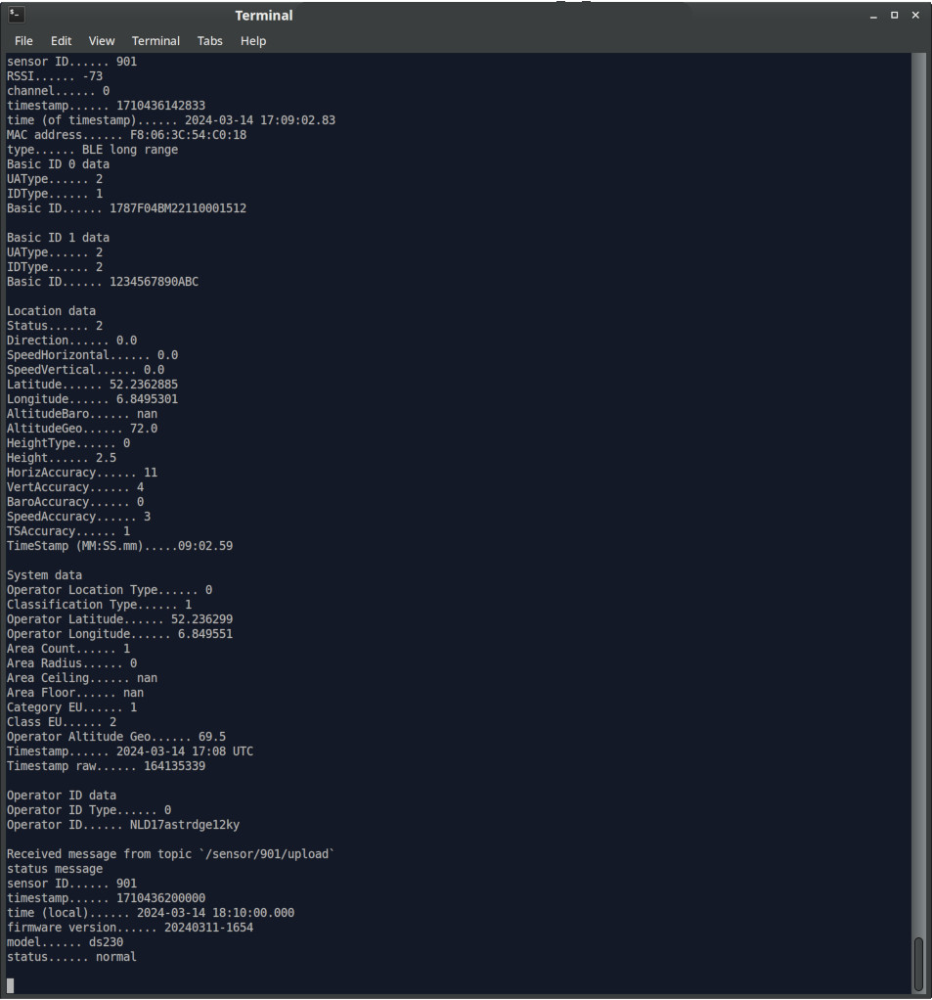
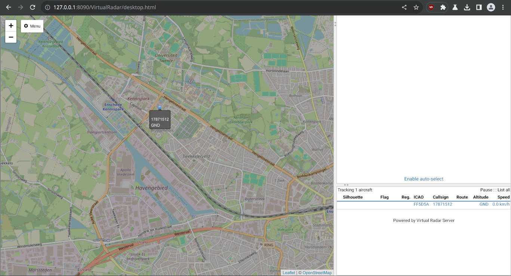
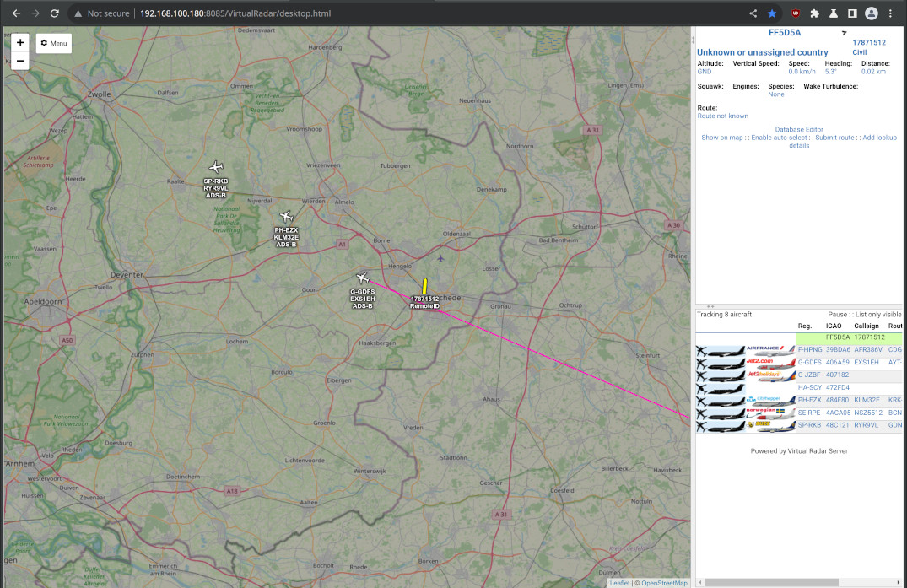

# RemoteID-MQTT-subscriber

## What is it?
This repository contains reference code to subscribe to a MQTT broker and parse data from DroneScout receivers (such as ds230, ds240 or DroneScout SDK). These receivers can be purchased at [https://dronescout.co/](https://dronescout.co/) The manual can be found here: [manual](https://download.bluemark.io/ds230.pdf)

DroneScout receivers detect broadcast/direct drone Remote ID signals (Bluetooth, WLAN); a <em>"wireless number plate"</em> technology that is or becomes mandatory in several parts of the world e.g. USA, EU, Japan. It supports all frequency bands (2.4 and 5 GHz) and transmission protocols (WLAN Beacon, WLAN NaN, Bluetooth 4 Legacy, Bluetooth 5 Long Range.)

\#OpenDroneID \#RemoteID \#FAA \#F3411 \#EASA \#DIN_EN_4709-002 \#dronetechnology

## Installation
The code is Python3 (3.7+) code. It needs these dependencies (tested under Ubuntu):

```
sudo apt install python3-paho-mqtt python3-bitstruct
 ```

or use pip3 to install these dependencies from `requirements.txt`

```
pip3 install -r requirements.txt
```

Avoid `sudo pip3 install`, as it installs into the system Python and can conflict with packages managed by apt. If you're not using a virtual environment and need a system-wide install, prefer `pip3 install --user -r requirements.txt`.

## Configuration
DroneScout receivers output data using [MQTT](https://en.wikipedia.org/wiki/MQTT). MQTT is a sensor protocol that consists of publishers, subscribers and a broker. DroneScout receivers are a MQTT publisher. You need a MQTT broker where the sensors output their sensor data. This script is a MQTT subscriber.

In the config.py file, enter the correct settings for the ``broker``, ``port``. Leave the ``topic`` to "#" to receive messages from all topics. Also add an ``username`` and ``password`` if your MQTT broker needs it. Note that `config.py` ships with a placeholder `broker = 'myserver'` — the script will not connect to anything until you replace it with your actual MQTT broker address.

It is also strongly advised to use secure SSL connection to the MQTT broker (``port`` 8883). For that also set the client_pem file. In case of non-SSL connections, use the ``port`` 1883.

If you want to log the detected Remote ID signals to a CSV file, please uncomment the ``log_path`` variable. Each message type gets its own CSV file in that folder: `*_remoteID_log.csv`, `*_aircraft_log.csv` (ADS-B/UAT, with RSSI in dBm when the sensor knows the tuner gain), `*_status_log.csv` (status, status details, WLAN radio and SDR receiver states) and `*_wlan_stats_log.csv` (WLAN statistics, one row per channel per interval).

Sensors without GPS (no LTE add-on), or whose GPS has no fix: give their position in ``sensor_locations`` (sensor ID -> latitude, longitude, altitude MSL). The integrations (TAK, SAPIENT, FLARM, CS-RID, ...) then get that position as the sensor's location, as long as the sensor sends no location message with a valid fix (for 3 minutes). A valid GPS position always wins. Location messages without a fix (0/0 or no satellites) are not passed on.

To disable printing of RemoteID message on the console uncomment ``print_messages`` variable and set it to False

The subscriber also allows exporting the detections via [SBS BaseStation](http://woodair.net/sbs/article/barebones42_socket_data.htm). See section SBS BaseStation.

## Add-ons
Besides broadcast/direct drone Remote ID signals, DroneScout receivers can receive other signals as well. This is introduced in firmware 20240927-1205 (and higher). For instance, an ADS-B 1090 MHz receiver can be added to the receiver. ADS-B transponder are used by most civil airplanes. ADS-B signals include the live location, flight ID and other information. Additonally in the USA (and some other countries), UAT at 978 MHz is used as well. This is a similar technology as ADS-B, but intended for smaller aircraft that fly at a lower alitude. Also DroneScout receivers can be equipped with an UAT 978 MHz receiver. Finally an LTE add-on (modem) can be integrated into the DroneScout receiver. This modem can be used for connectivity, but it can also be used as GNSS (GPS) receiver, so the sensor can tell where it is located. It can also publish mobile network statistics. More information at [https://dronescout.co/](https://dronescout.co/).

### Status and WLAN statistics
Newer firmware adds receiver health to the status message: `"status"` becomes `degraded` when an expected receiver does not work, `"status details"` says which one and why, and `"WLAN radios"` / `"SDR receivers"` give the state of each radio (`ok`, `quiet`, `stalled` or `missing`). The sensor also publishes a `"wlan statistics"` message per WLAN radio every interval (default 300 s), with per-channel packet counts, utilization, noise and signal levels, a congestion level for the RemoteID channel 6, receiver hardware counters and, with the LTE add-on, the LTE band. The subscriber prints these and logs them when `log_path` is set.

## Usage
Start the script to receive and show Remote ID signals of nearby drones.

```
python3 mqtt_sub.py
```



### SBS BaseStation
The subscriber code can output data via [SBS BaseStation](http://woodair.net/sbs/article/barebones42_socket_data.htm) on a net socket. To enable this, uncomment the variables sbs_``server_ip_address`` and ``sbs_server_port`` in config.py. Normally you only need to change the port. The IP address needs to be an IP address of the computer where this script runs. Only change it, if you want to have the SBS BaseStation export available on a particular network interface.

This export data format is used by programs that display ADS-B data from airplanes. Examples of such programs that support this data format are: [Virtual Radar Server](https://www.virtualradarserver.co.uk/) and [FlightAirMap](https://www.flightairmap.com/). A typical use case is, if you want to view both ADS-B data from airplanes and RemoteID signals from drones in one application. To configure a SBS BaseStation receiver in Virtual Radar Server, see this [link](https://www.virtualradarserver.co.uk/Documentation/WebServer/ReceiversOptions.aspx)

Note: for exporting data, the normal Serial Number of RemoteID is too long. It is decided in this implementation to use an ICAO code starting with FF. This range is **not** assigned to a country. The remaining 4-digits in the ICAO code are based on the Serial Number of the drone (hash). In this way, each drone has its own unique ICAO code. The 8-character call sign is based on the first 4 digits of the Serial Number (manufacturer code) and the last 4 digits.





### Integrations: TAK, SAPIENT, ASTERIX, REST, UDP, GDL90, FLARM, VMS and CS-RID
Gateways in [`integrations/`](integrations/README.md) pass the detections on to other systems. Both RemoteID and aircraft data (ADS-B, UAT, ADS-L, FLARM, OGN) are sent, see [which output sends what](integrations/README.md#remoteid-and-aircraft-data):

- [TAK](integrations/tak/README.md) (ATAK, WinTAK, iTAK, TAK Server): Cursor-on-Target map markers for drones, pilots, aircraft and sensors
- [SAPIENT](integrations/sapient/README.md) (BSI Flex 335 v2.0): every sensor as a SAPIENT node at a fusion node / DMM
- [ASTERIX](integrations/asterix/README.md): CAT021, CAT023, CAT129 (UAS identification), CAT062 and CAT065 over UDP
- [REST](integrations/rest/README.md): JSON over HTTP(S) POST with bearer, basic or API-key authentication
- [UDP](integrations/udp/README.md): one JSON datagram per event, multicast / broadcast / unicast on the local network
- [GDL90](integrations/gdl90/README.md): drones and aircraft as traffic in cockpit apps (ForeFlight, Garmin Pilot, SkyDemon)
- [FLARM](integrations/flarm/README.md): drones and aircraft as FLARM traffic in XCSoar, LK8000, SeeYou Navigator
- [VMS](integrations/vms/README.md): drone alarms as generic events in Milestone XProtect and Nx Witness
- [CS-RID](integrations/csrid/README.md) (experimental): DroneScout as a DRIP Crowd Sourced RemoteID Finder, with a reference SDSP

Each has its own README, settings file, test tools and (except UDP) a Docker test server.

## Testing
The repository has a pytest suite covering the opendroneid/aircraft message decoding, CSV export, MQTT message routing and the integrations. Install the extra test dependencies and run it from the repository root (see [integrations/README.md](integrations/README.md#unit-tests) for the SAPIENT and ASTERIX dependencies):

```
pip3 install -r requirements-dev.txt
pytest
```

## License
This project is licensed under the MIT License. See [LICENSE](./LICENSE) for details.
